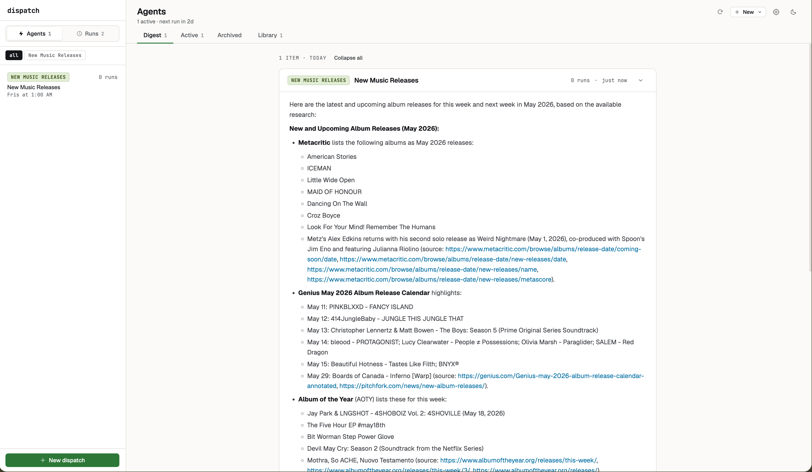

# dispatch

[](LICENSE)

Self-hosted AI research agent platform. Define agents for topics you care about, schedule them as dispatches, and get synthesized digests — no manual searching. Runs on your machine or server. Bring your own LLM (Ollama, OpenAI, Anthropic, Fireworks).



## What you get

- **Web UI** to browse, schedule, and read agent output — no config files required
- **Daily digest** compiled from the most recent run of each active agent
- **Multi-track pipelines** that fan out searches across independent topic tracks in parallel

## Quick Start

```bash
# 1. Create and activate a virtual environment
python -m venv dispatch-env
source dispatch-env/bin/activate

# 2. Install dependencies
pip install -r requirements.txt

# 3. Configure environment
cp .env.example .env
# Set SERVER_API_KEY if the server will be network-accessible (see .env.example)
# Everything else — provider, model, API keys, location — can be set in the Settings UI

# 4. Pull a model (Ollama only — skip if using a cloud provider)
ollama pull qwen3

# 5. Start the server
python main.py --serve        # http://localhost:8000
```

Open the web UI, go to **Library**, create your first agent, then click **Schedule** to activate it.

## How agents work

There are two distinct concepts: **agents** and **dispatches**.

- **Agent** — what an agent *is*: its name, goal, sources, search settings, and color. Agents live in the database and are the source of truth for behavior.
- **Dispatch** — an agent paired with a user prompt and a schedule. One agent can have multiple dispatches (e.g., the `news` agent running daily at 7am with a general prompt and again on Fridays with a weekly-recap prompt).

**No agents are active by default.** Create agents in the Library tab, then activate them by creating a dispatch.

```
Library tab — create and browse agents
                      ↓
           Schedule button →  creates a dispatch (agent + prompt + schedule)
                      ↓
           Active tab — running scheduled dispatches
```

## How it works

Each agent run uses a multi-phase micro-agent pipeline. Each phase is a small, focused LLM call with a constrained tool budget. The orchestrator (Python) manages state between phases; no single model call holds the full context.

```
query
  → Planner     (LLM) — generate N search queries (or skip if direct_sources set)
  → Searcher    (API) — fire all queries in parallel, collect results
  → Validator   (LLM) — coverage sufficient? retry with new queries if not
  → Synthesizer (LLM) — format final answer from research buffer
```

Optional phases (enabled per-agent via config):
- **Link validator** — HEAD-checks result URLs, drops dead ones before synthesis
- **Ranker + Fetcher** — LLM selects top URLs → parallel web_fetch → per-page summarizer

## Adding a new agent

**Option 1 — Web UI**


Library tab → **New agent** → fill in name, goal, sources, and color → Save. The agent immediately appears in the Library and can be scheduled.

**Option 2 — YAML**

Drop `.yaml` files into your agents directory (defaults to `./agents`, override with `DISPATCH_AGENTS_DIR` in `.env`). No agents folder is included in the repo — create it and add your own files.

Create `agents/my-agent.yaml`:

```yaml
name: my-agent
label: My Agent
description: What this agent covers.
color: 175                          # hue 0–359; omit to auto-assign on first seed
goal_template: "Find recent {query}. Focus on X, Y, Z."
output_template: "Return a bulleted digest with source links."
sources:
  - example.com
  - anothersource.org
tool_bindings:
  - web_search
planner_query_count: 5
freshness: w                        # d=24h  w=7d  m=30d  y=1y  (omit = any date)
```

Restart the server — the agent appears in the Library tab. Click **Schedule** to activate it.

**Option 3 — Import YAML**

Library tab → **Import** or `POST /api/agents/import` with a YAML body. Useful for migrating agents between instances.

### YAML field reference

| Field | Type | Default | Description |
|---|---|---|---|
| `name` | string | required | Unique slug — used as the agent identifier everywhere |
| `label` | string | `""` | Display name shown in pills and headers |
| `description` | string | `""` | Short summary shown in the Library table |
| `color` | integer | random | Hue (0–359) for the color pill. Auto-assigned on first seed if omitted; never overwritten by re-seeding |
| `goal_template` | string | required | LLM prompt for what to find. `{query}` → user input, `{today}` → YYYY-MM-DD |
| `output_template` | string | `""` | Instructions for how the synthesizer should format the response |
| `sources` | list | `[]` | Domains to bias planner queries toward (e.g. `sfchronicle.com`) |
| `direct_sources` | list | `[]` | URLs fetched directly, bypassing the planner. `{today}` substitution supported |
| `sub_queries` | list | null | Multi-track pipelines — each track runs an isolated search pass (see Pipeline modes) |
| `tool_bindings` | list | `["web_search"]` | Tools available to this agent. Empty list = all tools |
| `freshness` | string | null | Date filter: `d` `w` `m` `y` |
| `planner_query_count` | integer | `5` | Number of search queries the planner generates |
| `max_validator_loops` | integer | `1` | How many times the validator can request additional searches |
| `validate_links` | bool | `false` | HEAD-check each result URL and drop dead ones before synthesis |
| `fetch_content` | bool | `false` | Rank URLs by relevance, fetch top 5 full pages, summarize per page |

## Pipeline modes

The pipeline is selected automatically based on your config. All modes end with a Validator loop and a Synthesizer call.

### 1. Search (default)

```yaml
# no direct_sources
tool_bindings: [web_search]
```

LLM planner generates `planner_query_count` queries → parallel web search across all providers → validate → synthesize.

Best for news, research, any topic where broad query coverage helps. `sources` narrows the planner's focus toward specific domains without locking it to them.

### 2. Search + deep read

```yaml
tool_bindings: [web_search, web_fetch]
fetch_content: true
```

Same as search, but after collecting results the pipeline ranks all URLs by relevance, fetches the top 5 full pages, runs a per-page summarizer, and uses the extracted facts for synthesis instead of raw snippets.

Best for agents where the article body matters — detailed reporting, analysis, documentation. Slower (~2× more LLM calls) but higher-quality output.

### 3. Direct feed

```yaml
direct_sources:
  - https://example.com/feed?date={today}
  - https://api.example.com/posts
tool_bindings: [web_fetch]  # required — or omit tool_bindings entirely
```

Skips the LLM planner entirely. Each URL is fetched directly (with `{today}` substituted as YYYY-MM-DD). Results go straight into the research buffer.

Best for RSS feeds, known API endpoints, or structured data pages updated on a schedule. Note: `tool_bindings` must include `web_fetch` or be empty — the default `["web_search"]` will silently skip direct URLs.

### 4. Domain-biased search

```yaml
sources:
  - sfchronicle.com
  - missionlocal.org
```

The LLM planner is given `sources` as a hint — it generates queries biased toward those domains but still searches the open web. Not a hard filter.

Best for agents that should prefer specific publications without being locked to them.

### 5. Multi-track

```yaml
sub_queries:
  - label: research
    goal: "Find recent ML papers about {query}"
    sources: [arxiv.org, paperswithcode.com]
    query_count: 3
    freshness: w
  - label: industry
    goal: "Find business news about {query} in AI"
    sources: [techcrunch.com, venturebeat.com]
    query_count: 3
```

N independent search pipelines run in parallel, each with its own goal, sources, freshness, and query count. Results are aggregated into a final synthesizer call.

Best for agents covering multiple distinct topics that benefit from isolated query sets (e.g., AI papers vs industry news vs tooling). Note: `fetch_content` and `direct_sources` are not inherited by sub-pipelines — each track is search-only.

### Options that apply across all modes

**`validate_links`** — HEAD-checks every result URL and drops dead ones before synthesis. Adds a few seconds, improves source quality.

**`max_validator_loops`** — the validator judges whether the research buffer is sufficient. If not, it generates retry queries and reruns the search phase. Default `1` means one pass (no retry). Set to `2`–`3` for agents where completeness matters more than speed.

## LLM providers

Configure via the **Settings UI** (gear icon) or set in `.env`. Cloud providers automatically use larger context windows and higher parallelism than local Ollama.

| Provider | `PROVIDER=` | Recommended models |
|---|---|---|
| Ollama (default) | `ollama` | `qwen3` / `qwen3:1.7b` (fast) |
| OpenAI | `openai` | `gpt-4.1` / `gpt-4.1-mini` (fast) |
| Anthropic | `anthropic` | `claude-sonnet-4-6` / `claude-haiku-4-5-20251001` (fast) |
| Fireworks | `fireworks` | `llama-v3p3-70b-instruct` / `llama-v3p1-8b-instruct` (fast) |

Set `MODEL` for the primary model and optionally `FAST_MODEL` for a smaller model used in the Planner/Validator phases.

## Search providers

Web search fans out across multiple providers in parallel, merges and deduplicates results. **DuckDuckGo works out of the box — no key required.** Add any of the following free-tier providers to expand coverage:

| Provider | Key | Free tier | Notes |
|---|---|---|---|
| **Ollama Cloud** | `OLLAMA_API_KEY` | [ollama.com](https://ollama.com) | Recommended; primary fan-out provider |
| **Brave Search** | `BRAVE_API_KEY` | 2K queries/month — [brave.com/search/api](https://brave.com/search/api/) | Good general coverage |
| **Jina Search** | `JINA_API_KEY` | [jina.ai](https://jina.ai/) | Also enables Jina Reader for page fetching; `site:` queries excluded |
| **DuckDuckGo** | none | always-on | Baseline; 60s circuit-breaker, auto-recovers |

Page fetching uses `requests` with automatic fallback to **Jina Reader** (`r.jina.ai`) when a page returns thin content — catches JavaScript-rendered shells transparently. Set `WEB_FETCH_PROVIDER=jina` to always use Jina.

## Environment variables

### Required (set in `.env` before first run)

These are read at startup before the UI is accessible and cannot be changed via the Settings UI.

| Variable | Default | Description |
|---|---|---|
| `SERVER_API_KEY` | unset | Bearer token for the HTTP API. Set this if the server is network-accessible — without it anyone who can reach the host can trigger runs and read your data. Not needed for localhost use. |
| `SERVER_HOST` | `0.0.0.0` | Interface to bind |
| `SERVER_PORT` | `8000` | Port to listen on |

### Configurable in the Settings UI

Open the gear icon in the web UI to change these at any time. A server restart is required for changes to take effect. See `.env.example` for the full list with comments.

| Variable | Default | Description |
|---|---|---|
| `PROVIDER` | `ollama` | LLM backend: `ollama`, `openai`, `anthropic`, `fireworks` |
| `MODEL` | `qwen3` | Primary model for synthesis |
| `FAST_MODEL` | unset | Smaller model for Planner/Validator phases; falls back to `MODEL` |
| `OLLAMA_BASE_URL` | `http://localhost:11434` | Ollama server address |
| `OPENAI_API_KEY` | — | Required if `PROVIDER=openai` |
| `ANTHROPIC_API_KEY` | — | Required if `PROVIDER=anthropic` |
| `FIREWORKS_API_KEY` | — | Required if `PROVIDER=fireworks` |
| `BRAVE_API_KEY` | — | Brave Search — 2K queries/month free |
| `JINA_API_KEY` | — | Jina Search + higher Reader rate limits |
| `LOCATION` | unset | City/region injected into planner prompt for location-aware searches |
| `CONTEXT_BUDGET` | `cloud` | `cloud` / `local` / `minimal` — controls content truncation for local models |
| `TEMPERATURE` | `0.2` | LLM sampling temperature |
| `TIMEOUT` | `300` | LLM request timeout in seconds |

### Not in Settings UI (`.env` only)

| Variable | Default | Description |
|---|---|---|
| `OLLAMA_API_KEY` | — | Ollama Cloud search key — [ollama.com](https://ollama.com) |
| `WEB_FETCH_PROVIDER` | `http` | `http` (raw fetch + Jina fallback) or `jina` (always use Jina Reader) |
| `DISPATCH_DB_PATH` | `search_history.db` | SQLite path |
| `DISPATCH_AGENTS_DIR` | `./agents` | YAML seed files directory |
| `PLANNER_QUERY_COUNT` | `5` | Global default for `planner_query_count` (overridden per-agent) |
| `PARALLEL_SUB_PIPELINES` | `1` | Max parallel workers for multi-track pipelines; `0` = sequential |

## Web UI

The web UI (`/`) is a single-page app. The main area shows the current conversation; the sidebar manages agents and schedules.

### Tabs

**Digest** — a compiled briefing assembled from the most recent run of each active agent. Skips agents that haven't run yet.

**Active** — all enabled dispatches (agent + prompt + schedule). Each card shows the agent pill, label, next run time, and last run status. Click a card to view the last output, edit the schedule, or run it immediately.

**Archived** — disabled dispatches. Re-enable from here without losing the schedule.

**Library** — all agents in the database, whether scheduled or not. Browse, create, edit, and export agents here.

### Agent type

When creating or editing an agent, select the agent type first:

- **Web Search** — the planner generates queries and searches the web. Configure preferred domains, fetch content, and freshness filter.
- **Direct Fetch** — provide a list of URLs to fetch directly (no search). `{today}` is substituted with the current date. Best for feeds and known API endpoints.

Tool bindings are inferred automatically from the type and don't need to be set manually.

### Creating and scheduling an agent

1. **Library → New agent** — give it a name, label, goal template, sources, and optionally a color swatch
2. Save — the agent appears in the Library table immediately
3. Click **Schedule** on the new row — the dispatch sheet opens with the agent pre-selected
4. Enter the prompt the agent will run with (e.g. "SF local news digest"), set frequency and time, save
5. The agent appears in **Active** and will run on schedule


### Editing agents

Accessible from Library → Edit or by clicking a row. Fields map directly to the YAML schema above. Changes take effect on the next run without a server restart.

### Settings

The gear icon (top-right) opens the Settings sheet. Changes are saved to `.env` and take effect after a server restart.

| Section | What you can configure |
|---|---|
| LLM Provider | Provider, model, API key, Ollama base URL, fast model |
| Search | Ollama Cloud, Brave, and Jina API keys |
| Personalization | Location (used by local-aware agents) |
| Advanced | Context budget, temperature, LLM timeout |

### Other UI features

- **+ New** — start a one-off prompt against any agent (no schedule)
- **think** — toggle Qwen3 reasoning mode for the current prompt
- **Stop** — cancel a running job; shows live elapsed time while running
- Responses rendered as markdown with clickable links

## CLI

```bash
python main.py --serve                                        # start server
python main.py --agent news                                   # interactive
python main.py --agent news --once                            # run once and exit
python main.py --agent apartment --once --query "2br sf soma under 3000"
```

### Scheduling via system crontab (alternative to UI schedules)

```bash
0 7  * * *   cd /path/to/dispatch && python main.py --agent my-agent --once
0 8  * * 1   cd /path/to/dispatch && python main.py --agent my-agent --once --query "weekly recap"
```

## Deploying as a service

A systemd service file is included at `deploy/dispatch.service`. Copy it to `/etc/systemd/system/`, update the paths, and:

```bash
sudo systemctl enable dispatch
sudo systemctl start dispatch
```

The server reads `.env` from the working directory and auto-restarts on failure.

## Tools

| Tool | Description |
|---|---|
| `web_search` | Fan-out search across Ollama, Brave, Jina, and DDG in parallel; results merged and deduplicated |
| `web_fetch` | Fetch full page content from a URL; falls back to Jina Reader for JS-rendered or thin pages |

## Files

```
main.py             # CLI entry point and dispatcher
pipeline.py         # AgentPipeline and MultiAgentPipeline orchestrators
agent_loader.py     # loads DB agent rows → DomainConfig objects at runtime
agent_config.py     # DomainConfig and SubQueryConfig dataclasses
agents/             # optional YAML files — import via UI or POST /api/agents/import
server.py           # FastAPI HTTP server and web UI
db.py               # SQLite schema, CRUD, and YAML seed loader
tools.py            # Tool definitions (web_search, web_fetch) and dispatch
ui.html             # single-page web UI (served at /)
logs.py             # CLI tool for reviewing session history
requirements.txt
.env.example
deploy/             # systemd service file
search_history.db   # created on first run (gitignore this)
```

## SQLite schema

```sql
sessions    (id, model, agent, source, started_at, ended_at, viewed_at, total_duration_ms)
messages    (id, session_id, role, content, created_at)
tool_calls  (id, session_id, tool_name, args, result, duration_ms, created_at)
dispatches  (id, agent, prompt, schedule, label, enabled, run_on_create, created_at,
             trigger_type, repeat_until, max_runs, run_count)
agents      (id, name, label, description, enabled, color,
             goal_template, output_template,
             sources, sub_queries, tool_bindings, direct_sources,
             freshness, planner_query_count, max_validator_loops,
             validate_links, fetch_content,
             is_builtin, created_at, updated_at)
settings    (key TEXT PRIMARY KEY, value TEXT, updated_at TEXT)
```

`source` in sessions is `cli`, `http`, or `cron`. `role` in messages is `user`, `assistant`, or `error`.

`dispatches.schedule` is a standard 5-field cron expression. Schedules are managed by APScheduler inside the server process and persist across restarts.

`agents.color` is a hue integer (0–359). Auto-assigned randomly when an agent is first created if not specified in YAML.

### Querying history

**CLI (`logs.py`)**
```bash
python logs.py              # last 50 sessions
python logs.py -n 100       # last 100 sessions
python logs.py --agent news # filter by agent
python logs.py --session 42 # full detail for session 42
```

**Direct SQLite**
```sql
-- Recent sessions with first prompt
SELECT s.id, s.agent, s.started_at,
  (SELECT content FROM messages WHERE session_id=s.id AND role='user' ORDER BY id LIMIT 1) AS prompt
FROM sessions s ORDER BY s.id DESC LIMIT 20;

-- Search by keyword
SELECT * FROM messages WHERE content LIKE '%keyword%';

-- Tool calls for a session
SELECT tool_name, args, result FROM tool_calls WHERE session_id=42;
```

**Python (`db.py`)**
```python
import db
sessions = db.get_sessions(limit=50, agent="news")
detail   = db.get_session_detail(42)
results  = db.search_sessions(agent="news", keyword="market")
```

## HTTP API

```
GET  /                          web UI
GET  /health                    sanity check

POST /api/jobs                  submit a job (async)
GET  /api/jobs/{job_id}         poll status / result
DELETE /api/jobs/{job_id}       cancel a running job

GET  /api/sessions              list sessions (?agent=news&limit=50)
GET  /api/sessions/{id}         full session detail (messages + tool calls with duration)

GET  /api/dispatches            list dispatches
POST /api/dispatches            create a dispatch
PUT  /api/dispatches/{id}       update a dispatch
DELETE /api/dispatches/{id}     delete a dispatch

GET  /api/agents                list all agents
GET  /api/agents/{name}         full agent detail
POST /api/agents                create an agent
PUT  /api/agents/{name}         update an agent
DELETE /api/agents/{name}       delete a non-builtin agent
GET  /api/agents/{name}/export  export agent as YAML
POST /api/agents/import         create/update agent from YAML body

GET  /api/tools                 list available tools

GET  /api/settings              current settings (values from live environment)
POST /api/settings              save settings to DB + .env (restart required to apply)

POST /v1/chat/completions       OpenAI-compatible (synchronous)
GET  /v1/models
```

### Authentication

```bash
python -c "import secrets; print(secrets.token_urlsafe(32))"
```

Set as `SERVER_API_KEY=...` in `.env`. If unset, all requests are accepted.

> **Note:** When `SERVER_API_KEY` is set, the server injects it into the web UI's HTML on page load so the frontend can authenticate its API calls automatically. This means the key is visible in the browser's View Source on the `/` route. Keep the server on a trusted network (localhost, Tailscale, private LAN) — don't bind to a public interface without additional network-level access controls.

## License

MIT — see [LICENSE](LICENSE).
